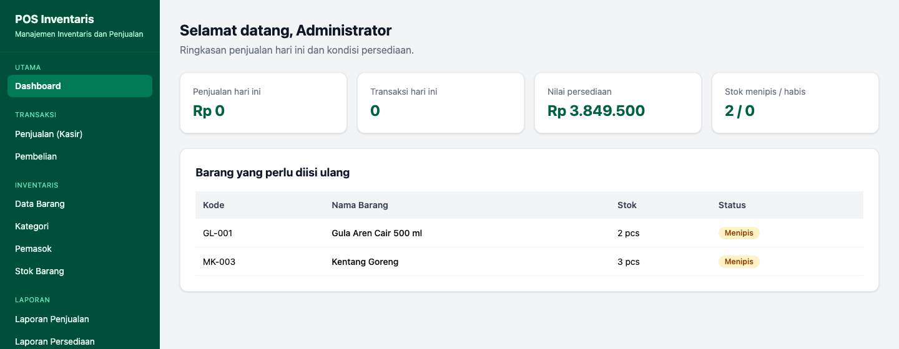
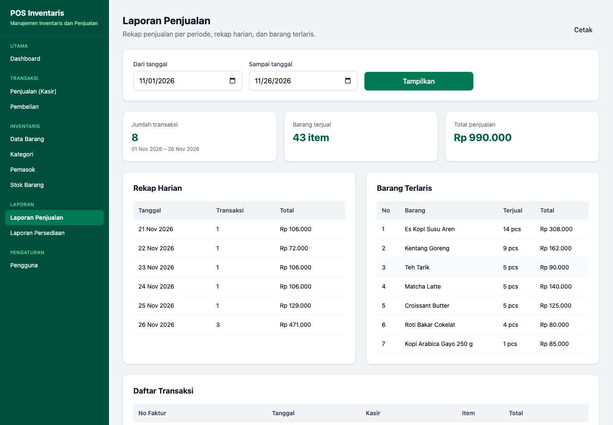

# Aplikasi POS Inventaris dan Penjualan untuk Kafe dan Restoran

Aplikasi Manajemen Inventaris dan Penjualan Barang merupakan aplikasi *point of sales* (POS) sederhana yang ditujukan bagi usaha kafe dan restoran. Aplikasi ini dikembangkan dari modul praktikum pembuatan CRUD data barang dengan menggunakan Laravel 13 sebagai *backend* (REST API), React sebagai *frontend*, dan Tailwind CSS 4 sebagai kerangka kerja antarmuka.



## Daftar Isi

1. [Fitur Aplikasi](#fitur-aplikasi)
2. [Tampilan Aplikasi](#tampilan-aplikasi)
3. [Teknologi yang Digunakan](#teknologi-yang-digunakan)
4. [Instalasi](#instalasi)
5. [Mencoba Aplikasi melalui GitHub Codespaces](#mencoba-aplikasi-melalui-github-codespaces)
6. [Hak Akses Pengguna](#hak-akses-pengguna)
7. [Pengujian](#pengujian)
8. [Struktur Proyek](#struktur-proyek)
9. [Dokumentasi](#dokumentasi)

## Fitur Aplikasi

Tabel 1. Fitur aplikasi

| No. | Fitur | Keterangan |
|---|---|---|
| 1 | Autentikasi dan manajemen pengguna | Autentikasi menggunakan token Laravel Sanctum dengan dua peran, yaitu admin dan kasir. |
| 2 | Manajemen data barang | Pengelolaan data barang, termasuk pengunggahan gambar, pencarian, dan penomoran halaman. |
| 3 | Manajemen kategori barang | Kategori digunakan pada formulir barang dan laporan persediaan. |
| 4 | Manajemen pemasok | Data pemasok digunakan pada transaksi pembelian. |
| 5 | Transaksi pembelian barang | Nomor faktur dibuat secara otomatis; stok dan harga beli barang diperbarui. |
| 6 | Transaksi penjualan barang | Kasir memilih barang, memasukkan jumlah pembayaran, dan sistem menghitung kembalian. |
| 7 | Pengelolaan stok barang | Posisi stok, penyesuaian hasil stok opname, dan kartu stok. |
| 8 | Laporan penjualan | Laporan per periode yang memuat rekapitulasi harian dan barang terlaris. |
| 9 | Laporan persediaan | Nilai persediaan dan status stok (aman, menipis, atau habis). |
| 10 | Pengujian dan dokumentasi | Pengujian otomatis dengan PHPUnit dan dokumen teknis aplikasi. |

## Tampilan Aplikasi

Tabel 2. Tangkapan layar aplikasi

| Transaksi penjualan | Transaksi pembelian |
|---|---|
|  |  |
| **Kartu stok** | **Laporan penjualan** |
|  |  |

Tangkapan layar halaman lainnya tersedia dalam direktori [`presentasi/screenshot`](presentasi/screenshot).

## Teknologi yang Digunakan

Tabel 3. Teknologi yang digunakan

| Komponen | Teknologi |
|---|---|
| *Backend* | Laravel 13 dan Laravel Sanctum |
| *Frontend* | React dan Vite |
| Kerangka kerja CSS | Tailwind CSS 4 |
| Basis data | MySQL; pengujian menggunakan SQLite *in-memory* |
| Klien HTTP | Axios |
| Penyimpanan gambar | Laravel Storage |

## Instalasi

### Prasyarat

Perangkat lunak yang perlu dipasang terlebih dahulu adalah PHP versi 8.3 atau yang lebih baru, Composer, Node.js, dan MySQL.

### Mengunduh Kode Sumber

```bash
git clone https://github.com/dripadd/BNSP.git
cd BNSP
```

### Menyiapkan *Backend*

1. Pasang dependensi dan buat berkas konfigurasi.

   ```bash
   cd backend
   composer install
   cp .env.example .env
   php artisan key:generate
   ```

2. Buat basis data, misalnya `db_barang`, kemudian sesuaikan koneksi basis data pada berkas `.env`.

   ```env
   DB_CONNECTION=mysql
   DB_DATABASE=db_barang
   DB_USERNAME=root
   DB_PASSWORD=
   ```

3. Tentukan akun admin pertama pada berkas `.env`. Langkah ini bersifat opsional. Apabila `ADMIN_PASSWORD` dikosongkan, kata sandi acak akan dibuat dan ditampilkan satu kali pada terminal saat proses *seeding*.

   ```env
   ADMIN_EMAIL=admin@contoh.com
   ADMIN_PASSWORD=
   ```

4. Jalankan migrasi, *seeding*, dan tautan penyimpanan, kemudian jalankan peladen.

   ```bash
   php artisan migrate
   php artisan db:seed
   php artisan storage:link
   php artisan serve
   ```

   *Backend* dapat diakses melalui `http://127.0.0.1:8000`.

### Menyiapkan *Frontend*

Jalankan perintah berikut pada terminal kedua.

```bash
cd frontend
npm install
npm run dev
```

Aplikasi dapat diakses melalui `http://localhost:5173`. Setelah masuk sebagai admin, buat akun kasir melalui menu **Pengguna**. Permintaan ke `/api` dan `/storage` diteruskan ke *backend* melalui *proxy* Vite.

## Mencoba Aplikasi melalui GitHub Codespaces

Aplikasi dapat dicoba langsung di peramban tanpa instalasi lokal melalui GitHub Codespaces.

[](https://codespaces.new/dripadd/BNSP?quickstart=1)

1. Klik tombol di atas, atau pilih **Code**, kemudian **Codespaces**, lalu **Create codespace on main**.
2. Tunggu proses penyiapan otomatis selama sekitar tiga sampai lima menit.
3. Buka port **5173 (Aplikasi POS)** pada tab **Ports**.
4. Masuk dengan akun demo yang tercantum pada berkas `backend/storage/app/demo-akun.txt`.

Codespace bersifat sementara dan berhenti secara otomatis apabila tidak digunakan. Petunjuk lengkap tersedia pada [.devcontainer/README.md](.devcontainer/README.md).

## Hak Akses Pengguna

Tabel 4. Hak akses berdasarkan peran

| Kemampuan | Admin | Kasir |
|---|---|---|
| Melakukan transaksi penjualan | Ya | Ya, hanya dapat melihat transaksi milik sendiri |
| Melihat data barang dan stok | Ya | Ya |
| Mengelola barang, kategori, dan pemasok | Ya | Tidak |
| Melakukan transaksi pembelian dan penyesuaian stok | Ya | Tidak |
| Mengakses laporan, dasbor, dan manajemen pengguna | Ya | Tidak |

## Pengujian

Pengujian otomatis dijalankan dengan perintah berikut.

```bash
cd backend
php artisan test --compact
```

Pengujian menggunakan basis data SQLite *in-memory* sehingga tidak memengaruhi basis data MySQL. Cakupan pengujian meliputi autentikasi, hak akses berdasarkan peran, data induk, transaksi pembelian dan penjualan, pengelolaan stok, serta laporan.

## Struktur Proyek

```
backend/                      Laravel 13 (REST API)
  app/Http/Controllers/Api/   Pengendali (controller) setiap fitur
  app/Models/                 Model Barang, Kategori, Pemasok, Pembelian, Penjualan, StokMutasi, User
  database/migrations/        Skema basis data
  tests/Feature/              Pengujian fitur
frontend/                     React, Vite, dan Tailwind CSS
  src/pages/                  Halaman setiap fitur
  src/components/             Komponen antarmuka bersama
  src/services/               Pemanggilan API dengan Axios
presentasi/                   Presentasi tahapan pembuatan aplikasi (PPTX dan PDF)
DOKUMENTASI.md                Dokumen teknis aplikasi
```

## Dokumentasi

1. [DOKUMENTASI.md](DOKUMENTASI.md) memuat skema basis data, daftar *endpoint* API, aturan bisnis, dan skenario uji manual.
2. [presentasi/Aplikasi%20POS%20Inventaris%20dan%20Penjualan%20untuk%20Kafe%20dan%20Restoran.pdf](presentasi/Aplikasi%20POS%20Inventaris%20dan%20Penjualan%20untuk%20Kafe%20dan%20Restoran.pdf) memuat tahapan pembuatan aplikasi, mulai dari modul CRUD data barang hingga aplikasi POS.

Gambar contoh barang pada tangkapan layar bersumber dari Wikimedia Commons dengan lisensi bebas. Daftar pembuat dan lisensi setiap gambar tercantum pada [DOKUMENTASI.md bagian 9](DOKUMENTASI.md#9-sumber-gambar-contoh-barang).
