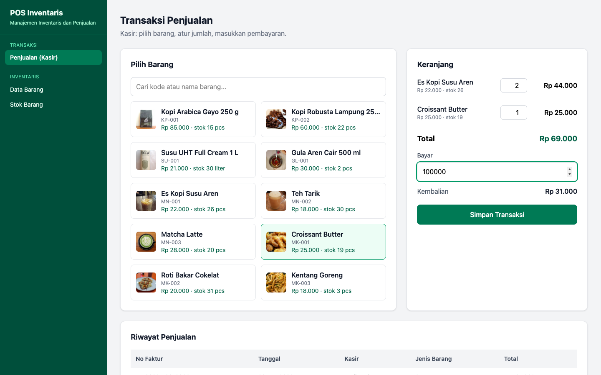
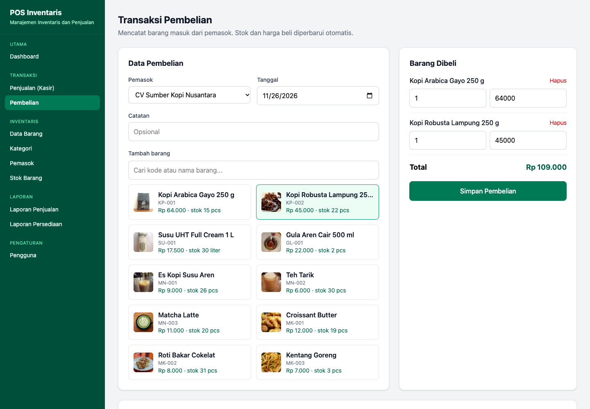
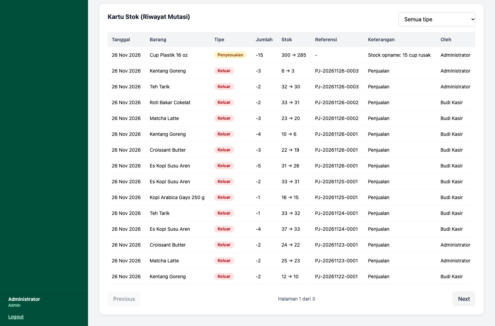

# Aplikasi Manajemen Inventaris dan Penjualan Barang (POS Sederhana)

Aplikasi Point of Sales (POS) sederhana untuk kafe dan restoran, dibangun dengan **Laravel 13** (REST API), **React** (Vite), dan **Tailwind CSS 4**. Aplikasi ini adalah pengembangan dari modul praktikum CRUD Data Barang.


## Fitur

| No | Fitur | Keterangan |
|---|---|---|
| 1 | Login dan manajemen pengguna | Token Laravel Sanctum, peran **admin** dan **kasir**, menu menyesuaikan peran |
| 2 | Manajemen data barang | CRUD barang dengan upload gambar, pencarian, dan pagination |
| 3 | Manajemen kategori barang | Kategori dipakai di form barang dan laporan persediaan |
| 4 | Manajemen pemasok | Data pemasok untuk transaksi pembelian |
| 5 | Transaksi pembelian | Nomor faktur otomatis, stok bertambah, harga beli diperbarui |
| 6 | Transaksi penjualan (kasir) | Keranjang, pembayaran, kembalian, validasi stok |
| 7 | Pengelolaan stok | Posisi stok, penyesuaian stock opname, kartu stok |
| 8 | Laporan penjualan | Per periode, rekap harian, barang terlaris |
| 9 | Laporan persediaan | Nilai persediaan dan status stok (Aman, Menipis, Habis) |
| 10 | Pengujian dan dokumentasi | 24 tes PHPUnit dan [DOKUMENTASI.md](DOKUMENTASI.md) |

## Tampilan

| Transaksi penjualan (kasir) | Transaksi pembelian |
|---|---|
|  |  |
| **Kartu stok** | **Laporan penjualan** |
|  |  |

Screenshot lain ada di folder [`presentasi/screenshot`](presentasi/screenshot).

## Teknologi

| Komponen | Teknologi |
|---|---|
| Backend | Laravel 13, Laravel Sanctum |
| Frontend | React, Vite |
| CSS | Tailwind CSS 4 |
| Database | MySQL (pengujian memakai SQLite in-memory) |
| HTTP client | Axios |
| Penyimpanan gambar | Laravel Storage |

## Instalasi

Prasyarat: PHP 8.3+, Composer, Node.js, dan MySQL.

```bash
git clone https://github.com/dripadd/BNSP.git
cd BNSP
```

### Backend

```bash
cd backend
composer install
cp .env.example .env
php artisan key:generate
```

Atur koneksi database di `.env`, lalu buat database-nya (misalnya `db_barang`):

```env
DB_CONNECTION=mysql
DB_DATABASE=db_barang
DB_USERNAME=root
DB_PASSWORD=
```

Opsional: tentukan akun admin pertama di `.env`. Bila `ADMIN_PASSWORD` dikosongkan, password acak dibuat dan ditampilkan sekali di terminal saat seeding.

```env
ADMIN_EMAIL=admin@contoh.com
ADMIN_PASSWORD=
```

```bash
php artisan migrate
php artisan db:seed
php artisan storage:link
php artisan serve        # http://127.0.0.1:8000
```

### Frontend

Di terminal kedua:

```bash
cd frontend
npm install
npm run dev              # http://localhost:5173
```

Buka `http://localhost:5173`, login sebagai admin, lalu buat akun kasir lewat menu **Pengguna**. Frontend meneruskan `/api` dan `/storage` ke backend lewat proxy Vite.

## Peran pengguna

| Kemampuan | Admin | Kasir |
|---|---|---|
| Transaksi penjualan | Ya | Ya (melihat transaksinya sendiri) |
| Melihat barang dan stok | Ya | Ya |
| Kelola barang, kategori, pemasok | Ya | Tidak |
| Transaksi pembelian, penyesuaian stok | Ya | Tidak |
| Laporan, dashboard, manajemen pengguna | Ya | Tidak |

## Pengujian

```bash
cd backend
php artisan test --compact
```

Pengujian memakai database SQLite in-memory, sehingga tidak menyentuh database MySQL. Cakupannya meliputi autentikasi, hak akses per peran, data master, transaksi pembelian dan penjualan, stok, serta laporan.

## Struktur project

```
backend/                 Laravel 13 (REST API)
  app/Http/Controllers/Api/   Controller per fitur
  app/Models/                 Barang, Kategori, Pemasok, Pembelian, Penjualan, StokMutasi, User
  database/migrations/        Skema database
  tests/Feature/              Pengujian fitur
frontend/                React + Vite + Tailwind CSS
  src/pages/                  Halaman per fitur
  src/components/             Komponen UI bersama
  src/services/               Pemanggilan API (Axios)
presentasi/              Presentasi tahapan pembuatan aplikasi (PPTX dan PDF)
DOKUMENTASI.md           Skema database, endpoint API, aturan bisnis, skenario uji
```

## Dokumentasi

- [DOKUMENTASI.md](DOKUMENTASI.md): skema database, daftar endpoint API, aturan bisnis, dan skenario uji manual.
- [presentasi/Aplikasi_Barang.pdf](presentasi/Aplikasi_Barang.pdf): tahapan pembuatan aplikasi dari modul CRUD barang sampai POS.

Gambar contoh barang pada screenshot berasal dari Wikimedia Commons dengan lisensi bebas. Daftar pembuat dan lisensinya ada di [DOKUMENTASI.md bagian 9](DOKUMENTASI.md#9-sumber-gambar-contoh-barang).
